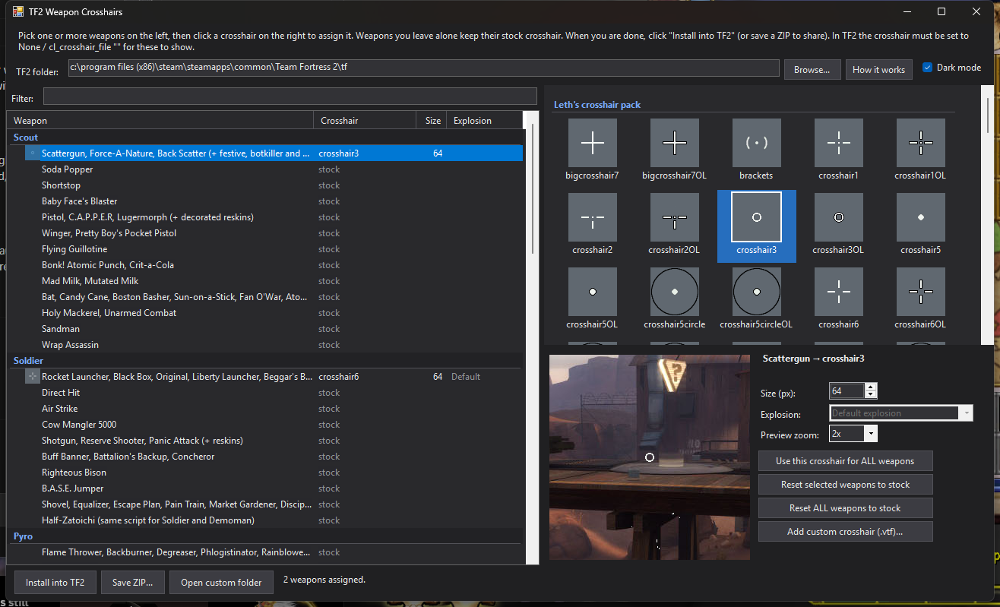

# TF2 Weapon Crosshairs

A small Windows app that gives every Team Fortress 2 weapon its own crosshair.
It works like the [cfg.tf weapon-specific crosshairs tool](https://cfg.tf/tools/crosshairs/),
but covers every weapon script the game has (the cfg.tf list stopped being updated years ago),
lets you set the crosshair size per weapon, previews the result over a game screenshot,
and can write the files straight into your TF2 folder.

## Download and install

There is no installer. The app is one portable exe: download it, keep it anywhere (the Downloads
folder is fine) and run it.

1. Open the [Releases page](https://github.com/wizardengie/tf2-vtf-crosshairs/releases/latest) and
   download **TF2Crosshairs.exe** ([direct link](https://github.com/wizardengie/tf2-vtf-crosshairs/releases/latest/download/TF2Crosshairs.exe)).
   It is about 47 MB, needs nothing else installed and works on 64-bit Windows 10 and 11. (Smaller
   alternative: `TF2Crosshairs-slim.exe`, about 1 MB, which needs the
   [.NET 10 Desktop Runtime](https://dotnet.microsoft.com/download/dotnet/10.0); Windows offers the
   download link if it is missing.)
2. Double-click it. Windows may show **"Windows protected your PC"** the first time, because the app
   is not code-signed. Click **More info**, then **Run anyway**.
3. Pick weapons on the left and a crosshair on the right, then click **Install into TF2**.
4. In TF2, open the options and set the crosshair to **None** (`cl_crosshair_file ""`), otherwise the
   game keeps drawing its own. Restart TF2 if it was running.

Your setup is saved to `%APPDATA%\TF2Crosshairs`, so it is still there next time you open the app.



## Using it

The app finds your TF2 install through Steam and shows the `tf\custom` folder it will install into. If
it cannot find it, click **Browse...** and pick `Steam\steamapps\common\Team Fortress 2\tf\custom`.

Select one or more weapons on the left (Ctrl/Shift-click for several, or click a class name such as
**Scout** to select every weapon of that class), then click a crosshair on the right. It is assigned
immediately and shown in the preview.

- **Size** changes how big the crosshair is drawn in game (64 px is what cfg.tf used).
- **Explosion** lets explosive weapons use one of the smoke-free explosion effects instead of the
  stock one, the same five choices cfg.tf offers.
- Weapons you leave alone keep their stock crosshair. **Reset selected weapons to stock** under the
  preview un-assigns the selection; **Reset ALL weapons** at the bottom clears everything so you can
  start over.
- **Install into TF2** writes `tf\custom\crosshairs` and removes what it wrote last time, so
  un-assigning a weapon really puts it back to stock. The crosshair colour still comes from TF2's
  normal crosshair colour settings.

The app starts in dark mode; the **Dark mode** checkbox at the top right switches to a light theme and
is remembered too.

**Sharing with friends:** either send them the exe, or click **Save ZIP...** and have them extract
it into `Team Fortress 2\tf\custom` so they end up with `tf\custom\crosshairs`.

**Your own crosshairs:** click **Add custom crosshair (.vtf)...**. 64x64 textures work best. The
matching `.vmt` material is generated for you and the file is copied into the package.

## How it works

TF2 reads a weapon's settings from `scripts/tf_weapon_<name>.txt`. The game ships those scripts
encrypted (`.ctx`), but the engine looks for a plain `.txt` in `tf/custom` first and only then falls
back to the encrypted file. The app takes a copy of each stock script, replaces its `crosshair`
texture block with one that points at `materials/vgui/replay/thumbnails/<crosshair>` and writes it
into `tf/custom/crosshairs/scripts`. The crosshair textures go into that `replay/thumbnails` folder
because the game does not validate it under `sv_pure`, which is the same trick cfg.tf and the
original [weapon-specific crosshair guide](https://www.teamfortress.tv/30866/guide-weapon-specific-custom-crosshairs)
rely on. Test on the servers you play on; a strict community server can still block custom files.

The explosion options rewrite the `ExplosionEffect`, `ExplosionPlayerEffect` and
`ExplosionWaterEffect` lines of the script with the particle names cfg.tf uses. If you already use a
"no explosion smoke" mod, remove it and pick the effect here instead, otherwise the two will fight
over the same script files.

## Weapon list

[`assets/weapons.tsv`](assets/weapons.tsv) maps each script to the weapons that use it. It was built
from the game's own `items_game.txt` (every item's `item_class`) plus the per-class translation TF2
applies in its source code (`tf_weapon_shotgun` becomes `tf_weapon_shotgun_soldier` for Soldier,
all-class melee weapons use each class's stock melee script, and so on). Things worth knowing:

- The Gas Passer uses `tf_weapon_jar_gas`, not the Jarate/Mad Milk scripts cfg.tf listed it under.
- The Pain Train on Demoman uses the Bottle script; on Soldier the Shovel script.
- The B.A.S.E. Jumper is `tf_weapon_parachute_secondary` on Soldier and `tf_weapon_parachute_primary`
  on Demoman.
- All-class melee weapons (Frying Pan, Saxxy, Conscientious Objector, ...) use the class's stock melee
  script, except on Heavy where the game uses the Pyro Fire Axe script.
- Grappling Hook, PASS Time JACK, Spellbook and the Spy's watches have their own scripts and are listed
  under "All classes" / Spy.

## Building

You need the .NET 10 SDK, which comes with Visual Studio 2026 (or install it on its own). The project
targets `net10.0-windows` and opens in Visual Studio as a normal WinForms project.

```bat
dotnet publish src\TF2Crosshairs\TF2Crosshairs.csproj -c Release -r win-x64 --self-contained true -o dist\self-contained
dotnet publish src\TF2Crosshairs\TF2Crosshairs.csproj -c Release -r win-x64 --self-contained false -o dist\slim
```

The first command makes the self-contained exe (about 47 MB), the second the small one that needs the
.NET 10 Desktop Runtime. The GitHub Actions workflow does the same on every push and attaches both to a
release when you push a `v*` tag.

## Repository layout

| Path | What it is |
| --- | --- |
| `src/TF2Crosshairs/` | C# WinForms app on .NET 10. `Vtf.cs` decodes textures for the preview, `Packager.cs` writes the package, `Tf2Locator.cs` finds the game, `MainForm.cs` is the UI, `Gallery.cs` the hand-painted crosshair grid, `Theme.cs` the dark/light palettes. |
| `assets/crosshairs/*.vtf` | The 98 crosshair textures (Leth's pack, Tob's black brackets, xhairshadow, CPMA, Quake Live) from the cfg.tf repository. |
| `assets/crosshairs.tsv` | Which pack each texture belongs to (anything unlisted shows up under "Other"). |
| `assets/scripts/*.txt` | The stock weapon scripts, decrypted from the game's `.ctx` files, used as the base for patching. |
| `assets/weapons.tsv` | Class, script and weapon names shown in the list. |
| `assets/preview_bg.jpg` | The game screenshot behind the preview (from cfg.tf). |

To add a crosshair to the bundle, drop the `.vtf` into `assets/crosshairs`, add a line to
`assets/crosshairs.tsv` and rebuild; everything in `assets` is embedded into the exe.

## Credits

- [cfg.tf](https://cfg.tf) by mkrl (MIT) for the original tool, the crosshair packs it collects and the preview image.
- The crosshair authors: Leth (xhair pack), Tob (black brackets), xhairshadow, and whoever ported the CPMA and Quake Live sets.
- The weapon-specific crosshair method from the teamfortress.tv guide linked above.
- Valve for Team Fortress 2 and for publishing the game's source, which settled the per-class script names.
